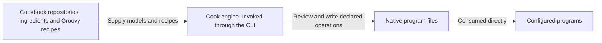
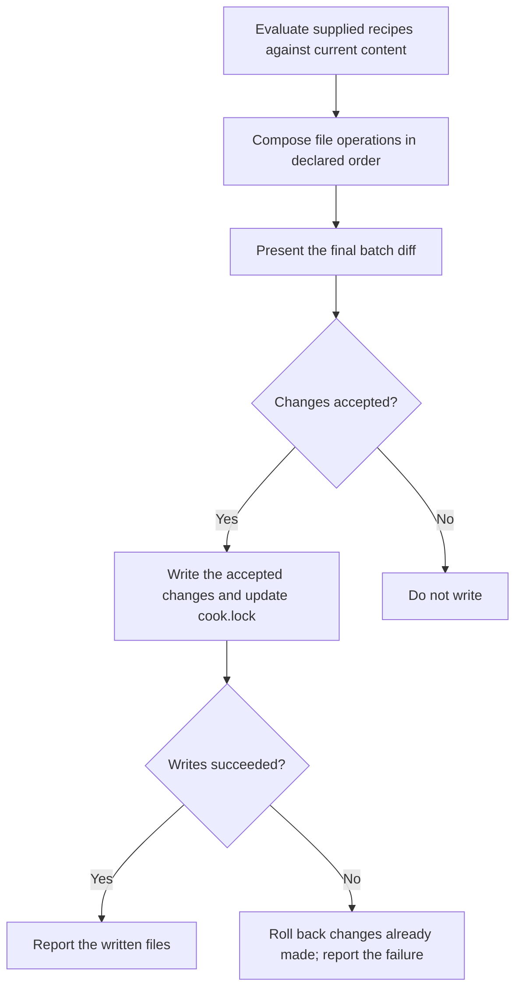

# Cook architecture

Cook is a recipe driven configuration engine. It evaluates trusted Groovy [recipes](features/glossary.md) into an
ordered batch of file operations, presents the resulting diff, obtains approval, and performs the writes.

This document states the intended architecture. Supporting design and reference documents follow it; descriptions of
the current implementation belong in the [root README](../README.md) and [core implementation guide](../core/README.md).
The numbered requirements (FR-1 and onward) are listed under [Requirements](#requirements), and
[ADRs](adrs/README.md) record the reasons and rejected alternatives behind them.

## Scope and responsibilities

Teams and developers reuse configuration across repositories. Copying that setup by hand makes improvements hard to
share and review. Cook makes the requested file changes visible as a diff, while cookbooks carry the program models
and recipes that describe the setup.

| Area | Responsibility | Requirement |
| --- | --- | --- |
| Cook engine | Evaluate trusted Groovy recipes, assemble their ordered file operations, present the diff, obtain approval, and perform the writes. | FR-1 |
| Ingredients and cookbooks | Model programs' native files and configuration in ingredients; hold and ship ingredients and recipes through cookbook repositories, with builds that can be separate from Cook's build. | FR-2 |
| Batch | Contain file operations, including directory and symlink operations where applicable. | FR-3 |
| Trust boundary | Govern declared batch operations with approval, output boundaries, and rollback. Recipe execution is trusted code, outside any sandbox guarantee. | FR-4 |
| Interfaces and builds | Keep the core independent of any interface. Expose cooking, running recipes, through the command line interface (CLI). Use Gradle to build and package Cook and cookbooks. | FR-5 |

## Ingredients, recipes, and cookbooks

An ingredient is a program data model: it models the files and configuration a program natively consumes. Examples
include Git's ignore file and Codex's configuration and skills. The ingredient concept preserves program knowledge.

A recipe is trusted executable Groovy code that describes requested file operations using these models. Evaluating
recipes produces the batch that Cook reviews and writes. The models describe program configuration; the engine
handles the resulting file operations. Each recipe has a short name that markers and the lock use to identify it. A
recipe cooked from a path is named by its place in the repository without `.groovy`, such as `recipes/setup`. A recipe
cooked by its coordinates is named by its address without the version, such as `io.github.lmarqs.cookbook:agents#connect`,
so cooking a new version keeps the same owner. Moving a recipe file renames it: cooking the new name and discarding the
old one moves the ownership ([discard](features/discard.md)).

A cookbook repository holds and distributes ingredients and recipes. Cookbook distribution is separate from engine
distribution: a cookbook releases as jars of its sources in Maven-layout repositories
([cookbook distribution](#cookbook-distribution)). Keeping program models in cookbooks lets their authors maintain
program-specific setup separately from the engine's evaluation, review, and writing responsibilities.

Cook writes native files so the configured programs consume their own configuration directly. A recipe may describe
agent settings, ignore rules, or build and CI files.



*Figure 1. System context: cookbook content, the engine, and configured programs. Answers FR-1, FR-2, and FR-5.*

## Evaluation, review, and writes



*Figure 2. Cooking operation flow, scoped to declared batch operations. Answers FR-1, FR-3, FR-4, FR-7, and FR-11
through FR-13.*

A batch contains file operations, including operations on directories and symlinks where applicable. Cook's recovery
and rollback responsibilities concern the declared file operations.

Recipes are trusted executable code and are not sandboxed. Approval, output boundaries, and rollback govern declared
batch operations. Recipe code can cause side effects outside the batch, and the diff and rollback do not cover those
effects. Trusting a recipe is therefore separate from approving its resulting file changes. See the
[safety invariants](adrs/0011-safety-invariants.md) and [cookbook trust](adrs/0026-cookbook-trust.md) ADRs.

### Ordered composition and declared targets

Recipes and their operations execute in declared order, left to right. Cook composes them against current content.
When two recipes write the same section, key, or file, the last one wins and becomes its owner; the diff is the only
notice. The preview is one combined diff from current content to the final result (FR-7). The
[ownership ADR](adrs/0007-ownership.md) records the reasons.

Cooking a batch affects its declared targets and the targets its recipes owned before. Cooking recipe B does not
remove output that recipe A owns, even when A is omitted from the new invocation. Cooking a new version of recipe A
removes what A's previous version owned and the new version no longer declares; the diff shows that removal (FR-8).
For example, suppose `settings.toml` initially has `test = "old"` and `other = "keep"`. Recipe A sets `test` to `A`
and creates `notes.txt`; recipe B sets `test` to `B`. Cooking A followed by B shows this final combined preview:

```diff
--- a/settings.toml
+++ b/settings.toml
@@ -1,2 +1,2 @@
-test = "old"
+test = "B"
 other = "keep"
--- /dev/null
+++ b/notes.txt
@@ -0,0 +1 @@
+Notes from recipe A.
```

The final value is B's result, and B owns `test`. If A was instead cooked in an earlier run and B is cooked alone
now, the preview changes `test = "A"` to `test = "B"`, moves ownership of `test` to B, and leaves `notes.txt` and
`other = "keep"` intact.

Targets have three forms (FR-10):

| Target | Address | Extent of the operation |
| --- | --- | --- |
| Whole file | File path | The declared file as a whole |
| Structured content | File path and key path | The declared key, preserving unrelated keys |
| Section in a shared text file | File path and begin/end markers | The bounded section, preserving text outside it |

A section's markers name the recipe that owns it and the region within that recipe:
`cook:begin <recipe>/<region>` and `cook:end <recipe>/<region>`. The recipe's short name precedes the last `/` and
the region follows it. Several recipes can therefore keep separate sections in one file. Markers use the file format's comment syntax: HTML comments in Markdown, and hash comments in ignore
files, YAML, TOML, and shell scripts. For example:

```markdown
Text outside the section stays in place.

<!-- cook:begin recipes/setup/commands -->
Run the project's build command.
<!-- cook:end recipes/setup/commands -->

More unrelated text stays in place.
```

```gitignore
# cook:begin git/ignore
/.claude/settings.local.json
# cook:end git/ignore
```

Ownership decides what a recipe's later versions update and remove. It does not block changes: Cook proposes the
requested changes against current content, and a manual edit inside an owned section or key appears in the next diff
like any other difference. Existing and edited content follows the same batch diff and approval flow as any other
change (FR-9).

### Batch approval and failure recovery

The core proposes the batch and writes only the changes it receives as accepted. It records only accepted changes in
`cook.lock`, so the lock always describes what was written. The core is independent of any interface (FR-5).

The CLI displays the final diff in the terminal and accepts the whole batch. Above the diff it displays each supplied
recipe's `@confirm` text, under the recipe's address; one question covers the texts and the diff. Without
preapproval, it asks before changing target files. With `--batch-approve`, it displays the texts and the diff and
proceeds without prompting. Noninteractive execution without that flag does not silently authorize writes (FR-12).
After the writes succeed, it prints each cooked recipe's `@yield` text under the recipe's address (FR-28).

If a write fails, roll back changes already made by the batch and report the failure, so the files stay as they were
(FR-13).

## Ownership and the lock

`cook.lock` is a YAML file at the kitchen's root that Cook writes each time it cooks. The kitchen keeps and commits it,
because it is the only record of which recipes were cooked and what each owns: without it, Cook cannot withdraw what
a recipe no longer declares, and a seed's refusal the first time its recipe is cooked cannot tell a file a recipe
wrote from one written by hand. For each cooked recipe it records the short name, the source, the source's sha256,
and the sections, keys, whole files and links the recipe owns. It records no recipe arguments (FR-14).

```yaml
# Written by the-cook; do not edit by hand.
version: 1
recipes:
  - name: "io.github.lmarqs.cookbook:agents#permissions"
    source: "io.github.lmarqs.cookbook:agents:0.0.0#permissions"
    sha256: "3f5a…"
    owns:
      sections:
        - file: ".agents/adapters/codex/rules/cook.rules"
          id: "io.github.lmarqs.cookbook:agents#permissions/commands"
      keys:
        - file: ".agents/adapters/claude/settings.json"
          path: ["permissions"]
  - name: "io.github.lmarqs.cookbook:agents#connect"
    source: "io.github.lmarqs.cookbook:agents:0.0.0#connect"
    sha256: "3f5a…"
    owns:
      sections:
        - file: ".gitignore"
          id: "io.github.lmarqs.cookbook:agents#connect/harnesses"
      links:
        - ".claude/skills"
```

The source is a path relative to the repository root or the recipe's coordinates. A key path is a
list, so a key containing a dot stays one segment; `links` lists the symbolic links a recipe owns. The sha256 identifies
the recipe version that produced the recorded ownership. It is the hash of the recipe's sources: for a path, the
recipe file, the models beside it and the files its `@resource` lines name; for coordinates, the artifact's files,
the same whichever repository supplied them. The hash is the sha256 of one line `<sha256 of the file>  <path>` per file, each ending in a
newline, sorted by the UTF-8 bytes of the path. The path is relative to the repository root for a recipe path and to
the artifact's directory for coordinates, separated by `/`, and both hashes are written in lower-case hex. Because
the lock is committed, every clone has the same ownership information.

Cooking works without the lock. When the lock is missing or names no entry for a recipe, Cook evaluates the recipe as
usual and shows the diff; it has no previous ownership to compare against, so it removes nothing on the recipe's
behalf (FR-25).

## Cooking and discard

**Cooking** evaluates the supplied recipes and proposes their declared additions and updates, together with the
removal of what each recipe owned before and no longer declares. Every run evaluates the supplied recipe versions
against current content, even after an identical earlier invocation; an unchanged result produces an empty diff
(FR-25).

**Discard** removes what `cook.lock` lists for each named recipe, without evaluating it: a marked section together
with its markers, a key, a whole file or a link. A file left empty is deleted, and the recipe's entry leaves the lock;
a lock that lists no recipe is deleted. Content the recipe does not own stays, including other recipes' sections,
hand-written text and files a seed wrote the first time the recipe was cooked. Discard removes; it does not restore
the values the recipe replaced, because the repository's history already holds them (FR-15).

For example, when `.gitignore` holds a hand-written line above the section `io.github.lmarqs.cookbook:agents#connect`
owns, discarding that recipe proposes, besides removing the links and files it owns:

```diff
--- a/.gitignore
+++ b/.gitignore
@@ -1,12 +1,1 @@
 /build/
-# cook:begin io.github.lmarqs.cookbook:agents#connect/harnesses
-!/.claude/
-/.claude/*
-!/.claude/settings.json
-!/.claude/skills
-!/.claude/commands
-# Claude Code skips AGENTS.md while any of these exists, so they stay out of commits.
-CLAUDE.md
-CLAUDE.local.md
-**/.claude/CLAUDE.md
-# cook:end io.github.lmarqs.cookbook:agents#connect/harnesses
```

Discard follows the same diff, whole-batch approval and failure rollback as cooking. To get back content from before
a run, use the repository's version control.

## Destination and source origins

The invocation's current working directory is the destination, regardless of where the Cook executable lives. Cook
never searches parent directories or asks version control for the destination
([core and contracts ADR](adrs/0023-core-and-contracts.md)). An existing directory inside the destination is a valid
target even when Cook did not create it ([directory layout ADR](adrs/0014-directory-layout.md)).
Declared writes and deletions stay within that directory, including paths resolved through symlinks. A target that
reaches outside the destination through a symlink is outside the permitted output boundary (FR-21). See the
[write boundary ADR](adrs/0012-write-boundary.md).

Recipes come from two places: a path inside the destination repository, or coordinates resolved from the
repositories the destination's `cook.toml` lists ([cookbook distribution](#cookbook-distribution)). A URL is not a
recipe operand; a recipe shared beyond one repository is published in a cookbook and cooked by its coordinates.
A recipe reads a file, such as a template, through a `@resource('<path>')` line, which gives it the file's text. For a
recipe path, the path resolves from the recipe's directory, and a file outside the repository, directly or through a
symbolic link, is refused, as is a recipe operand outside it; move the file into the repository. For coordinates, the
path names a file in the recipe's artifact (FR-22). A recipe compiles against the models of its own artifact: for
coordinates, the artifact's models; for a recipe path, the upper-case `.groovy` files in its directory.

For example, run this invocation from `/work/project`:

```sh
cd /work/project
./cook cookbook/recipes/project.groovy
```

Suppose the recipe declares `@resource('../templates/settings.toml') String settings` and writes it to
`settings.toml`:

| Recipe origin | Resource | Declared output |
| --- | --- | --- |
| `cookbook/recipes/project.groovy` | `cookbook/templates/settings.toml` | `settings.toml` |

## Command line and build boundary

The CLI is the public cooking interface, and Gradle builds and packages Cook and cookbooks (FR-5). Without a command
word, `./cook` cooks the recipes it is given; `discard` and `help` are the other commands. Batch options precede the
first recipe operand, and recipe arguments follow their recipe. The [CLI reference](features/cli.md) defines the
syntax, recipe operands, argument scope, and batch options (FR-17 through FR-20).

## Engine distribution

Cook uses JVM-based distribution with `jpackage`. Each platform-specific package contains the engine and a
bundled Java runtime. Distribute the complete package, including its runtime (FR-26).

A release is cut when the maintainer starts the `release` workflow; its version comes from the Conventional Commits
since the last `v*` tag. Nothing is published unless the Linux x64 and arm64 and macOS arm64 builds and their tests pass. A release
publishes:

- on GitHub, `the-cook-<version>-<platform>.tar.gz` for `linux-x64`, `linux-arm64` and `macos-arm64`, each a complete
  package with its `.sha256`, and the `cook` wrapper with its `.sha256`;
- on Maven Central, the `io.github.lmarqs.cookbook:agents` cookbook artifact and the cookbook Gradle plugin with its marker.

A repository commits the release's executable `./cook` wrapper, which pins the engine version and the checksum of
each package; [the wrapper](features/wrapper.md) describes pinning, checksum verification, first-use download,
caching, and explicit upgrades.

Engine releases supply the packaged runtime. Cookbook repositories hold and ship ingredients and recipes, with
builds that can be independent of the engine build. Users supply the recipe version they intend to cook;
`cook.lock` records which version produced the current ownership.

The root README's [install section](../README.md#install) describes installing a release.

## Cookbook distribution

A cookbook releases as one jar per artifact, holding its sources, resources and README, in a Maven-layout
repository; the build that publishes a release sets its version. The destination's committed `cook.toml` lists the
Maven-layout repositories coordinates resolve from, in order; without a `cook.toml`, Maven Central. A path entry
starting with `~/` is relative to the user's home, so a developer lists `~/.m2/repository`, last, to cook their own
cookbooks published to Maven local. A path entry to a cookbook's source directory, the one holding `cookbook.toml`,
serves that cookbook's artifacts at any version straight from their files, so its author cooks an edit with no build.
Coordinates name exact releases only.

`cook.lock` records a hash of the artifact's sources, so two builds of one release have one hash, and a different
hash under a recorded version shows as a changed source before the diff. The
[cookbook distribution ADR](adrs/0029-cookbook-distribution.md) records the reasons.

## Requirements

Other documents cite these requirements by number.

### Responsibilities and scope

- **FR-1:** Cook evaluates trusted Groovy recipes into an ordered batch of file operations. Cook presents the
  resulting diff, obtains approval, and performs the writes.
- **FR-2:** Ingredients model a program's native files and configuration, such as Git's ignore file or Codex's
  configuration and skills. Cookbooks hold and ship ingredients and recipes through their repositories; their builds
  can be separate from Cook's build.
- **FR-3:** Batches contain file operations, including directory and symlink operations where applicable. Executing
  external commands is not a batch action.
- **FR-4:** Recipes are trusted executable code. Approval, output boundaries, and rollback govern declared batch
  operations; they are not a sandbox or a guarantee against arbitrary side effects in recipe code.
- **FR-5:** The core is independent of any interface. The CLI is the public cooking interface. Gradle builds and
  packages Cook and cookbooks.

### Ordered operations and review

- **FR-7:** Recipes and their operations execute in declared order, left to right. When two recipes write the same
  section, key, or file, the last one wins and becomes its owner. Show the combined result as one batch diff.
- **FR-8:** Cooking a batch affects its declared targets and the targets its recipes owned before. Cooking recipe B
  does not remove output recipe A owns. Cooking a new version of a recipe removes what its previous version owned
  and the new version no longer declares.
- **FR-9:** Cook proposes the requested changes against current content, including content a developer edited.
  Ownership never blocks a change.
- **FR-10:** Whole-file targets use file paths; structured targets use key paths; sections in shared text files use
  `cook:begin <recipe>/<region>` and `cook:end <recipe>/<region>` markers in the file format's comment syntax,
  including HTML comments for Markdown.
- **FR-11:** The core proposes the batch, writes only the accepted changes, and records only those in `cook.lock`.
- **FR-12:** The CLI displays the final diff in the terminal, preceded by each supplied recipe's `@confirm` text, and
  accepts the whole batch. Without preapproval, it asks before changing target files. With `--batch-approve`, it
  displays the texts and the diff and proceeds without prompting. Noninteractive execution without this flag does not
  silently authorize writes.
- **FR-13:** On a write failure, roll back changes already made by the batch and report the failure.
- **FR-28:** After the writes succeed, the CLI prints each cooked recipe's `@yield` text. A declined or failed batch
  prints none.

### Ownership and discard

- **FR-14:** The repository commits `cook.lock`, a YAML file at its root. For each cooked recipe it records the short
  name, the source as a repository-relative path or coordinates, the sha256 of its sources (for a path, the recipe
  and its `@resource` files; for coordinates, the artifact's sources), and the owned sections, keys, files and links. It records no recipe
  arguments.
- **FR-15:** Discarding recipes removes what `cook.lock` lists for each, without evaluating them: a section with its
  markers, a key, a whole file or a link, deleting a file left empty, and drops each recipe's lock entry. It restores
  no earlier value. A recipe the lock does not list is refused.

### CLI grammar

- **FR-17:** The commands are `./cook [batch-options] <recipe> [recipe-arguments]...`, which cooks the recipes,
  `./cook discard [batch-options] <recipe>...`, and `./cook help [<recipe>]...`. With no arguments, `help` alone, or
  `--help` alone, show the usage. `help` prints each recipe's help from its source without running it. A first operand
  of exactly `discard` or `help` selects that command; a recipe file with one of those names is supplied as a path,
  such as `./discard`.
- **FR-18:** Recipe operands are paths inside the destination repository, or coordinates
  `group:artifact:version#recipe` resolved from the repositories the destination's `cook.toml` lists. An operand
  containing `://` is refused. A word is a
  recipe operand when it contains `/` or `:` or ends with `.groovy`, as `recipe.groovy` does; a recipe file with none
  of these marks is given with `./`, such as `./notes`.
- **FR-19:** Batch options precede recipe operands. Recipe arguments follow their recipe
  as `--name=value` or `--name value`, including shell-quoted values. After `--name`, the next word is its value unless
  it is a recipe operand, so a value that looks like an operand is written with `=`. A yes-or-no param is a bare
  `--name`, or `--name=false`, and takes no separate value. A recipe appears once per invocation. A misplaced batch
  option after a recipe receives the normal unknown-option error. Discard takes recipes without arguments.
- **FR-20:** `--batch-approve` is the only preapproval spelling.

### Paths

- **FR-21:** The current working directory is the destination, regardless of the executable location. Declared writes
  and deletions stay within that directory, including paths resolved through symlinks.
- **FR-22:** A recipe reads a file through `@resource`, resolved from a recipe path's directory inside the repository
  or from the recipe's artifact. A local operand or resource outside the repository is refused. A recipe compiles
  against the models of its own artifact, or for a recipe path, the models in its directory.
- **FR-25:** Cooking does not require `cook.lock`. Every invocation evaluates the supplied recipes against current
  content; nothing marks a recipe as already cooked. Without a lock entry, cooking removes nothing on a recipe's
  behalf.

### Distribution and documentation authority

- **FR-26:** Cook uses JVM-based distribution with jpackage, one platform-specific package containing Java, released for
  Linux x64 and arm64 and macOS arm64. A committed `./cook` wrapper, published with each release, pins a version and the checksum of
  each package, fetches the package on first use, refuses it unless its checksum matches, and caches it locally.
  Upgrades are explicit: a repository commits another release's wrapper.
- **FR-27:** This document states the intended architecture. Supporting documents follow it. Documents that cover the
  implementation describe its actual behavior.

## Outside this design

Configuring a loop runner or an agent through native files does not place its execution under Cook's control. A
text-based interface that chooses individual changes is a separate decision.
